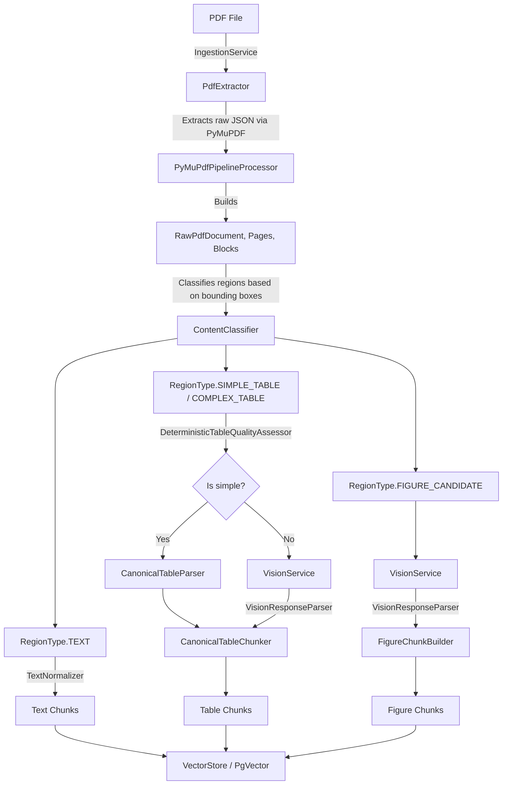
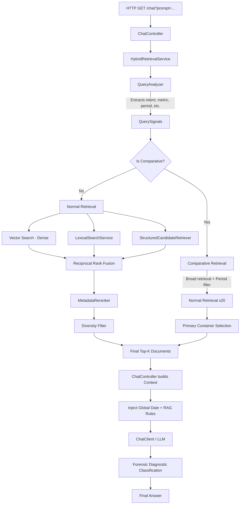
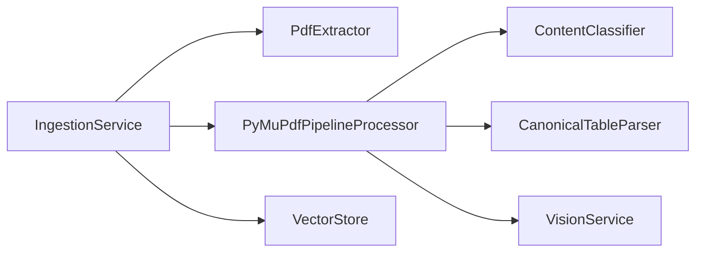
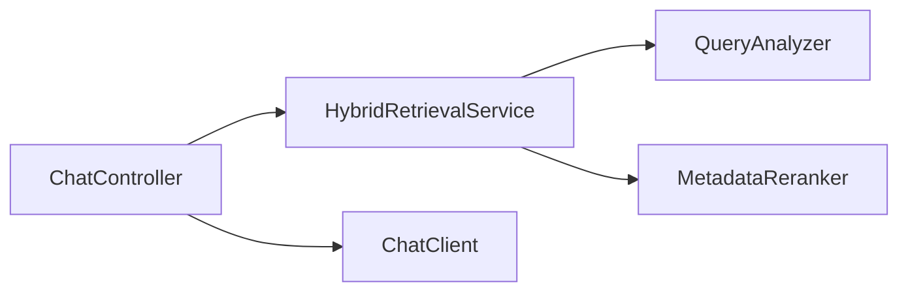

# PROJECT ARCHITECTURE AND LEARNING GUIDE

Welcome to the definitive learning handbook for the `financial-advisor-ai` repository. This document is designed to take you from a basic understanding of Java/Spring Boot to complete mastery of this specific application's architecture, data flows, and engineering decisions.

---

## 1. THE BIG PICTURE: What is this application doing?

This application is a **Multimodal Financial Document Retrieval-Augmented Generation (RAG) System**.

In plain language, it does the following:
1. **Ingests a financial PDF** (e.g., market reports).
2. **Extracts its content** physically using PyMuPDF (via Python).
3. **Classifies the content** to determine if a region on a page is narrative text, a structured table, or a complex figure/chart.
4. **Preserves structures** (like rows and columns in tables) so that the relationship between a financial entity and its numerical value is never lost.
5. **Uses Vision models (Gemini/Ollama)** to understand complex tables and charts that cannot be extracted deterministically.
6. **Creates canonical chunks** (Spring AI `Document` objects) enriched with heavy semantic metadata.
7. **Stores these chunks** in a PostgreSQL database using `pgvector` for semantic similarity search.
8. **Accepts natural-language financial questions** from users.
9. **Analyzes the question** to extract entities, metrics, periods, and comparison operations (e.g., "highest", "lowest").
10. **Retrieves evidence** using a Hybrid Retrieval strategy (Dense Vector + Lexical/BM25 + Structured).
11. **Fuses and Reranks** the retrieved evidence to surface the most factually relevant data while filtering out duplicates.
12. **Constructs a grounded prompt** containing only the retrieved evidence and strict temporal rules.
13. **Sends the prompt to an LLM** to generate a factual, concise answer, completely constrained by the evidence.

---

## 2. THE TWO MASTER PIPELINES

The application is strictly divided into two lifecycles: **Ingestion** (startup/admin time) and **Querying** (user runtime).

### DIAGRAM A: PDF INGESTION PIPELINE

### DIAGRAM B: QUERY / RAG PIPELINE

---

## 3. THE INGESTION PIPELINE IN DETAIL

**Scenario: Ingesting `article_thebeatoct2024.pdf`**

1. **`IngestionService`**: Runs at startup. Checks if the document is already in PostgreSQL. If not, it calls `PdfExtractor`.
2. **`PdfExtractor` (Implementation: `ProcessExecutionPdfExtractor`)**: Calls an external Python script using PyMuPDF.
   - *Why?* Java PDF libraries (like PDFBox) are notoriously bad at extracting exact bounding box coordinates and font sizes. PyMuPDF is the industry standard.
   - *Output:* A JSON string representing the physical layout.
3. **`PyMuPdfPipelineProcessor`**: Parses the JSON into `RawPdfDocument`. It iterates over every `RawPdfPage`.
4. **`ContentClassifier`**: Looks at the `RawPdfTextBlock`, `RawPdfTable`, and `RawPdfImage` coordinates.
   - *Logic:* It identifies if a text block overlaps with a table's bounding box. If so, it groups them into a `ContentRegion` of type `SIMPLE_TABLE` or `COMPLEX_TABLE`. If it's narrative text outside a table, it becomes `TEXT`. If it's a chart, it becomes a `FIGURE_CANDIDATE`.
5. **Table Processing**:
   - `ContentRegion` (Table) goes to `CanonicalTableParser`.
   - The parser aligns the text blocks horizontally and vertically to rebuild the grid into a `CanonicalTable` object containing rows and headers.
6. **Chunking**:
   - `CanonicalTableChunker` transforms the rows into Spring AI `Document` objects (chunks). It embeds rich metadata (e.g., `entity: S&P 500 Info Tech`, `metric: YTD`, `table_id: page_4_tbl_1`).
7. **Storage**:
   - `IngestionService` batches the `Document` objects and sends them to `VectorStore`, which generates embeddings and saves them in PostgreSQL `pgvector`.

*What could go wrong?* The Python script might crash. The `ContentClassifier` might mistakenly group text into a figure bounding box, swallowing the text. Debug this by looking at the logs in `PyMuPdfPipelineProcessor` for the exact number of text, table, and figure chunks created.

---

## 4. DETERMINISTIC EXTRACTION VS. VISION

**Why not just send the whole PDF to an LLM?**
LLMs have context window limits, suffer from the "lost in the middle" phenomenon, and are expensive. More importantly, LLMs hallucinate numbers from dense financial tables.

This project uses a dual approach:

1. **Deterministic Extraction (PyMuPDF)**: Fast, cheap, and 100% accurate for text and clean markdown tables. We prefer this whenever possible.
2. **Vision Extraction (`VisionService`)**: Used ONLY when deterministic extraction fails or is impossible (e.g., complex nested tables or visual charts/graphs).

**The Vision Path:**
- `ContentClassifier` identifies a `RegionType.FIGURE_CANDIDATE` or `COMPLEX_TABLE`.
- `PyMuPdfPipelineProcessor` crops the image of that region and sends a `VisionRequest` to `VisionService`.
- `GeminiVisionService` (or `OllamaVisionService` as fallback) processes the image using `VisionPromptTemplates`.
- The LLM returns structured JSON containing the chart's data points, which `VisionResponseParser` converts into a `FigureInterpretation`.
- Finally, `FigureChunkBuilder` turns this interpretation into chunks.

**Fallback Behavior:**
If Gemini is unavailable, `VisionService` falls back to Ollama (local vision model). If Vision is disabled entirely via config, complex tables fall back to best-effort deterministic parsing, and figures are skipped.

---

## 5. THE CANONICAL DATA MODEL

| Class | Represents | Created By | Used By | Important Fields |
|-------|------------|------------|---------|------------------|
| `RawPdfTextBlock` | Physical text on a page. | `PyMuPdfPipelineProcessor` | `ContentClassifier` | `text`, `bbox`, `fontSize` |
| `ContentRegion` | A spatially grouped set of elements. | `ContentClassifier` | `PyMuPdfPipelineProcessor` | `type`, `bbox`, `enclosedText` |
| `CanonicalTable` | A semantic representation of a table. | `CanonicalTableParser`, `VisionResponseParser`| `CanonicalTableChunker` | `title`, `headers`, `rows` |
| `FigureInterpretation`| Structured data extracted from a chart. | `VisionResponseParser` | `FigureChunkBuilder` | `summary`, `panels`, `dataPoints` |
| `Document` | Spring AI chunk ready for vector db. | Chunkers (`CanonicalTableChunker`, etc) | `VectorStore`, `HybridRetrievalService`| `id`, `content`, `metadata` |

*Why do these exist?* If we didn't have `CanonicalTable`, we would just slice a table string every 500 characters. A chunk might contain "30.31" without containing the column header "YTD" or the row entity "S&P 500 Info Tech". The canonical model prevents this catastrophic context loss.

---

## 6. CHUNKING

Chunking in this application is **semantic**, not naive.

- **Paragraph Chunk**: A block of narrative text.
- **Table Chunk**: In the new architecture, we chunk tables effectively by grouping rows or preserving the entire row with its headers.
- **Figure Chunk**: Data points extracted from a chart, contextualized with the chart's title and axis labels.

**Why did the corpus reduce from 968 to 446 chunks?**
The old architecture (Docling) used "cell-level" or "data-point level" chunking. A table with 10 rows and 5 columns produced 50 chunks. This caused **candidate flooding**: a search for "S&P 500" would retrieve 50 chunks from the exact same table, pushing out evidence from other pages. By adopting `CanonicalTableChunker` and grouping data logically (e.g., one chunk per row or small table), we reduced the total chunks while actually *increasing* the amount of context each chunk holds.

---

## 7. THE VECTOR DATABASE (PostgreSQL + pgvector)

The `VectorStore` (PostgreSQL) stores three things per chunk:
1. **Embedding**: A dense float vector representing the semantic meaning of the text.
2. **Text**: The actual string content to be injected into the LLM prompt.
3. **Metadata (JSONB)**: Key-value pairs used for exact filtering and reranking.

**Crucial Metadata Fields:**
- `chunk_type`: (e.g., "paragraph", "table", "figure_panel")
- `page_number`: For provenance and diversity filtering.
- `table_id` / `figure_id`: Identifies the container. Used to prevent pulling 10 chunks from the same table.
- `entity`: Extracted financial entity (e.g., "S&P 500").
- `metric`: Extracted metric (e.g., "YTD").

*Retrieval works by converting the user's query into an embedding, calculating cosine similarity against the database embeddings, and optionally filtering by the JSONB metadata.*

---

## 8. QUERY ANALYSIS

When the user asks: *"Which two S&P 500 sectors delivered the highest YTD total returns through September 30, 2024?"*

**`QueryAnalyzer`** intercepts the string and produces `QuerySignals`:
- **Entities**: `["S&P 500"]`
- **Metric**: `"TOTAL_RETURN"` (CanonicalMetric via `MetricResolver`)
- **Period**: `"YTD"`
- **Operation**: `MAXIMUM` (because of the word "highest")
- **Limit**: `2` (because of the word "two")
- **GroupBy**: `"sector"` (detected in text)
- **Comparative**: `true`

*Why?* If we just embed the raw question, the vector database searches for paragraphs that *sound like* a question. By extracting signals, we can perform structured SQL-like filtering (e.g., `WHERE metric = 'YTD'`) alongside vector search.

---

## 9. QUERY VS. RETRIEVAL QUERY

In `HybridRetrievalService`, you will see multiple searches:
1. `vectorSearch(query)`
2. `vectorSearch(retrievalQuery)`
3. `vectorSearch(entityQuery)`

**Original Query**: *"What were the two highest S&P 500 sector YTD returns?"*
**Retrieval Query**: *"S&P 500 total return YTD"*

*Why different queries?* The original query contains interrogative words ("What were the two highest") which dilutes the semantic embedding. The `retrievalQuery` strips stopwords to create a dense keyword phrase that aligns much better with the actual declarative text stored in the database. Searching *both* and merging the results ensures we catch documents that match either the semantic tone or the exact keywords. Duplicate document IDs are simply deduplicated in memory.

---

## 10. HYBRID RETRIEVAL (The Algorithm)

`HybridRetrievalService.normalRetrieval()` executes three parallel searches:

1. **Dense Semantic Retrieval**: Vector search. Great for understanding synonyms (e.g., "equities" matches "stocks"). Weakness: Terrible at exact number/acronym matching.
2. **Lexical Retrieval (`LexicalSearchService`)**: Keyword/BM25 search via Postgres Full-Text Search. Great for exact acronyms (e.g., "US IG"). Weakness: Fails on synonyms.
3. **Structured Retrieval (`StructuredCandidateRetriever`)**: Filters explicitly on metadata (e.g., `WHERE entity = 'S&P 500'`).

**Reciprocal Rank Fusion (RRF)**
RRF combines the ranked lists from the three channels.
Formula: `Score = 1 / (k + rank)` (where k is usually 60).
If Doc A is rank 1 in Dense, Rank 5 in Lexical: `(1/61) + (1/65)`.
This mathematically boosts documents that multiple channels agree are relevant (Consensus).

**Metadata Reranking & Diversity**
`MetadataReranker` inspects the fused list. If a chunk contains the exact entity the user asked for *in its metadata*, it gets a score boost.
Finally, the `applyDiversityFilter` ensures that we don't return 10 chunks from `table_id=1`. If we already have a chunk from `table_id=1`, the next one is deferred, allowing chunks from other pages to bubble up.

---

## 11. COMPARATIVE RETRIEVAL

If `QueryAnalyzer` detects `Operation: MAXIMUM` (e.g., "highest return"), `HybridRetrievalService.comparativeRetrieval()` takes over.

1. It retrieves a massive candidate pool (e.g., topK * 20).
2. It explicitly filters out chunks that do not match the requested period (`YTD`).
3. It performs **Primary Container Selection**. It looks at the `table_id` of the surviving chunks. If it notices that 15 of the chunks come from `table_12`, it deduces that `table_12` is the master comparison table.
4. It reorders the candidates to put all chunks from the primary container first.

*What it DOES NOT do:* It does not sort the actual numbers. It just ensures the LLM receives the entire table so the LLM can perform the math.

---

## 12. THE LLM BOUNDARY (Where Retrieval ends and Reasoning begins)

**Retrieval's Job:** Find the evidence.
**LLM's Job:** Read the evidence, perform logic, and format the answer.

**The Qwen Failure Case:**
Qwen was asked for the highest return. Retrieval correctly provided context showing:
`S&P 500 Info Tech: 30.31`
`S&P 500 Utilities: 30.63`
`Russell 1000 Defensive: 18.41`
Qwen output: "Utilities (30.63) and Russell (18.41)".
*Diagnosis:* This is an **LLM Reasoning Failure**. The retrieval system successfully delivered the correct facts, but the LLM failed to understand the mathematical comparison and entity filtering ("S&P 500").

**The Llama 3.1 Failure Case:**
Llama was asked for YTD returns. The table provided both YTD and 1Y columns. Llama returned the 1Y numbers.
*Diagnosis:* LLM Reasoning Failure. (Fixed by adding strict rules to the `ChatController` prompt).

---

## 13. CHATCONTROLLER AND THE RAG PROMPT

`ChatController` is the final orchestrator. It takes the retrieved `Document` strings and injects them into `RAG_PROMPT_TEMPLATE`.

**Important Prompt Rules:**
- **Temporal Anchor**: Injects the `activeReportingDate` (e.g., Sept 30, 2024). It tells the LLM that "Current" or "YTD" refers to this specific date.
- **Column Isolation**: Explicitly tells the LLM not to substitute "1Y" for "YTD".
- **Grounding/Abstention**: "If the context contains NO relevant evidence... state that the information is not provided."

---

## 14. FORENSIC DIAGNOSTICS

`ChatController.classifyResponseForensics()` is heuristic logging. It looks at the LLM's string output:
- If the LLM says "not provided", but the context actually contained the keywords = `ANSWERABILITY_MISCLASSIFICATION`.
- If the LLM says "not provided" and the context lacked keywords = `CORRECT_ABSTENTION`.
*Note: This is for console debugging, not rigorous evaluation.*

---

## 15. EVALUATION SUBSYSTEM

Located in `com.alsayed.financial_advisor_ai.evaluation`.
- **Purpose**: To quantitatively measure if changes to the retrieval logic or prompt break the system.
- **`EvaluationOrchestrator`**: Runs the dataset.
- **Metrics**: Uses Spring AI evaluators (Relevancy, Fact-Checking) or custom local metrics (Hit@K).
- **`RetrievalDebugService`**: Allows testing *just* the retrieval layer without waiting for the slow LLM generation.

---

## 16. HOW TO DEBUG THIS PROJECT

**Decision Tree: User gets the wrong answer**

1. **Check the final context sent to the LLM.** (Log output in ChatController)
   - *Are the correct facts present in the text?*
     - **YES**: The LLM hallucinated or failed reasoning. Tweak the `RAG_PROMPT_TEMPLATE` in `ChatController`, or use a smarter model.
     - **NO**: It is a retrieval or ingestion problem. Proceed to Step 2.

2. **Check the Vector Database (PgAdmin/SQL).**
   - *Is the missing fact in the database at all?*
     - **YES**: It's a Retrieval problem. The `HybridRetrievalService` failed to rank it highly. Check `QueryAnalyzer` to see if it misidentified the metric.
     - **NO**: It's an Ingestion/Chunking problem. Proceed to Step 3.

3. **Check Ingestion Logs (`PyMuPdfPipelineProcessor`).**
   - *Did PyMuPdf see the text? Was it classified as a table but chunked poorly?*
   - Fix `ContentClassifier` or `CanonicalTableParser`.

---

## 17. CONFIGURATION

Key files: `src/main/resources/application.yaml`

- `app.rag.search.hybrid.enabled`: Turns on/off Lexical and Structured search.
- `app.vision.enabled`: Turns on/off Gemini/Ollama image processing.
- `spring.ai.chat.client.provider`: Switches between `openai`, `ollama`, or `vertexai` (Gemini).
- `app.ingestion.force`: Set to `true` to wipe the vector store and re-ingest on startup.

---

## 18. CLASS-BY-CLASS MAP

### `IngestionService`
**Responsibility:** Orchestrates the ingestion pipeline at application startup.
**Created/Called by:** Spring Boot (`CommandLineRunner`).
**Calls:** `PdfExtractor`, `PyMuPdfPipelineProcessor`, `VectorStore`.
**Input:** PDF File.
**Output:** Populated Postgres Database.

### `PyMuPdfPipelineProcessor`
**Responsibility:** The brain of ingestion. Converts raw PDF data into canonical chunks.
**Calls:** `ContentClassifier`, `CanonicalTableChunker`, `VisionService`.
**Input:** `RawPdfDocument`.
**Output:** List of Spring AI `Document` chunks.

### `HybridRetrievalService`
**Responsibility:** The brain of retrieval. Executes searches across vector, lexical, and structured channels.
**Called by:** `ChatController`.
**Calls:** `QueryAnalyzer`, `VectorStore`, `MetadataReranker`.
**Output:** Top K ranked `Document` chunks.

### `QueryAnalyzer`
**Responsibility:** Parses user intent.
**Called by:** `HybridRetrievalService`, `EvaluationController`.
**Input:** Raw user string.
**Output:** `QuerySignals` (entities, metric, period, operation).

---

## 19. DEPENDENCY / CALL GRAPHS

### Ingestion Call Graph

### Query Call Graph

---

## 20. DATA LIFECYCLE TABLE

| Stage | Data Representation | Example | Producer | Consumer |
|-------|---------------------|---------|----------|----------|
| Extraction | `RawPdfTextBlock` | `"30.31"` (x, y coords) | `PdfExtractor` | `ContentClassifier` |
| Classification | `ContentRegion` | Grouped Table BBox | `ContentClassifier`| Parsers / Vision |
| Canonical | `CanonicalTable` | Row: S&P 500, YTD, 30.31| `CanonicalTableParser`| `CanonicalTableChunker`|
| Chunking | Spring AI `Document`| Text + Metadata JSON | Chunkers | `VectorStore` |
| Query | `QuerySignals` | Entity="S&P 500", Metric="YTD"| `QueryAnalyzer` | `HybridRetrievalService`|
| Final | String (Prompt) | "Context: ... Answer this:"| `ChatController` | LLM |

---

## 21. "READ THE CODE IN THIS ORDER" PLAN

Do not jump randomly. Read in this exact sequence:

1. **`Application.java` & `application.yaml`**
   - *Goal:* Understand config toggles and entry point.
2. **`IngestionService.java`**
   - *Goal:* See how a PDF starts its journey. Look at the chunk sanitization and batched saving.
3. **`model/raw/RawPdfDocument.java` & `model/region/ContentRegion.java`**
   - *Goal:* Understand the physical layout data structures.
4. **`PyMuPdfPipelineProcessor.java`**
   - *Goal:* Watch how regions are mapped to Text, Table, or Vision chunkers.
5. **`ContentClassifier.java`**
   - *Goal:* Understand the spatial logic (bounding boxes, intersections) that separates tables from charts.
6. **`CanonicalTableChunker.java`**
   - *Goal:* Understand how a table row becomes a metadata-rich chunk.
7. **`ChatController.java`**
   - *Goal:* Understand the query entry point, the `RAG_PROMPT_TEMPLATE`, and forensic logging.
8. **`QueryAnalyzer.java` & `QuerySignals.java`**
   - *Goal:* See how regex and registries turn text into structured intents.
9. **`HybridRetrievalService.java`**
   - *Goal:* Master the RRF fusion, diversity filtering, and comparative retrieval logic.

---

## 22. SELF-TEST QUESTIONS

**Level 1: Architecture**
*Q: Why is Vision not used for everything?*
A: It is slow, expensive, and LLMs hallucinate numbers from dense tables. Deterministic parsing is preferred.

**Level 2: Ingestion**
*Q: Why do we have raw models and canonical models?*
A: Raw models represent visual geometry on a page. Canonical models represent semantic relationships (rows, columns).

**Level 3: Query Analysis**
*Q: What is the difference between a query and a retrieval query?*
A: The query is the natural question ("What is the..."). The retrieval query strips stopwords ("S&P 500 total return") for better dense vector similarity.

**Level 4: Retrieval**
*Q: What does RRF solve?*
A: It mathematically merges ranked lists from different algorithms (Vector + Lexical) by rewarding consensus.

**Level 5: Debugging**
*Q: Where would you debug if a number reaches the LLM but the model chooses the wrong number?*
A: `ChatController.java`. The `RAG_PROMPT_TEMPLATE` must be updated with stricter rules, as this is an LLM reasoning failure.

---

## 23. ONE-PAGE CHEAT SHEET

**PROJECT PURPOSE:** Multimodal Financial RAG system preserving tabular and visual data via deterministic and vision-based extraction.

**INGESTION PATH:**
PDF → PyMuPDF → Raw Models → ContentClassifier → Canonical Parsers / Vision Service → Chunkers → PgVector

**QUERY PATH:**
Question → ChatController → QueryAnalyzer → HybridRetrievalService (Dense+Lexical+Structured → RRF → Rerank) → ChatController (Prompt Construction) → LLM → Answer

**FAILURE LAYERS:**
1. Extraction (PyMuPDF failed)
2. Classification (Table detected as Figure)
3. Chunking (Headers detached from rows)
4. Retrieval (Wrong chunks ranked top)
5. LLM Reasoning (LLM failed math/comparison)

**MOST IMPORTANT CLASSES:**
- `PyMuPdfPipelineProcessor`
- `ContentClassifier`
- `HybridRetrievalService`
- `QueryAnalyzer`
- `ChatController`
